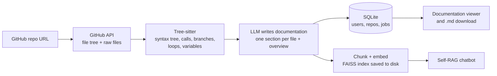
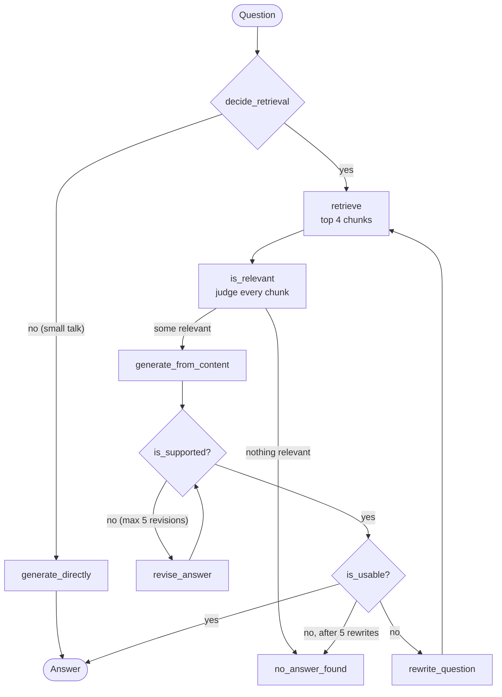

<div align="center">

# 🔍 RepoLens

### See inside any repository.

**Paste a GitHub repo. Get complete documentation. Ask it questions.**


</div>

---

RepoLens reads a GitHub repository the way a new teammate would. It parses every important file, has an LLM
write precise documentation that explains the code and its logic, and then opens a chatbot that answers
questions **only from that documentation**, checking its own answers for hallucinations before it replies.

Jupyter notebooks get a proper analysis (workflow, data, models, results, reproducibility), not just a code
walkthrough. Every user has their own account, and everything they analyse is saved, so they can come back
to a repo days later and carry on where they stopped.

<!--
  Add screenshots here once you have them, for example:
  
  
-->

## Contents

- [Highlights](#highlights)
- [How it works](#how-it-works)
- [The Self-RAG chatbot](#the-self-rag-chatbot)
- [Notebook analysis](#notebook-analysis)
- [The app](#the-app)
- [Tech stack](#tech-stack)
- [Project structure](#project-structure)
- [Getting started](#getting-started)
- [Configuration](#configuration)
- [API reference](#api-reference)
- [Security notes](#security-notes)
- [Limitations](#limitations)
- [Roadmap](#roadmap)
- [Troubleshooting](#troubleshooting)

## Highlights

| | |
|---|---|
| **Documentation for any repo** | One Markdown document: a project overview plus a section for every analysed file, covering its purpose, every class and function, data flow, and dependencies. Download it as `.md`. |
| **Code-aware, not just text-aware** | Tree-sitter builds a syntax tree of each file, so the LLM is given facts (imports, functions, calls, branches, loops, assigned variables) instead of guessing from raw text. |
| **Chat that checks itself** | A LangGraph **Self-RAG** loop decides whether to retrieve, judges each chunk's relevance, verifies the answer is grounded in the docs, and rewrites the question when the answer isn't useful. |
| **Notebook analysis** | `.ipynb` files are turned into an analysis of their workflow, data, models, saved results, and reproducibility problems (cells never run, out-of-order execution, no random seed, and more). |
| **Pick up where you left off** | Jobs, documentation, and search indexes are stored on the server. Refresh the page, close the browser, restart the server: your repos are still there, and a running analysis can be reopened from **My repos**. |
| **Multi-user** | Register, log in with JWT, and manage your profile. Every record belongs to a user, and one user can never see or delete another's data. |
| **A UI with a point of view** | A dark, lens-themed React interface with live analysis progress, a documentation library, and a profile area. |

## How it works



1. **Fetch.** The repo URL is validated, then the file tree and the source files are fetched through the
   GitHub API. Dependencies, build output, and oversized files are skipped, and at most 30 source files are documented.
2. **Analyse.** Each file is parsed with Tree-sitter. Per function it records parameters, the number of
   branches, loops, and returns (a control-flow summary), the variables it assigns (a data-flow hint), and
   the functions it calls.
3. **Document.** The LLM writes a section per file from that analysis plus the source, then a project-level
   overview. If the LLM fails for a file, its raw analysis is kept so the document is never incomplete.
4. **Index.** The documentation is chunked (1000 characters, 150 overlap), embedded with
   `all-MiniLM-L6-v2`, and stored as a FAISS index on disk. Each chunk is prefixed with its file name.
5. **Chat.** Questions run through the Self-RAG graph below, searching only this repo's documentation.

Analysis runs as a background job. The browser polls its progress, and the job is saved in the database.

## The Self-RAG chatbot

The chatbot is a [LangGraph](https://github.com/langchain-ai/langgraph) state machine. It doesn't just
retrieve and answer. It grades its own work:



| Node | What it does |
|---|---|
| `decide_retrieval` | Greetings and questions about the assistant skip retrieval. Anything about the repo's code uses it. |
| `retrieve` | Pulls the 4 most similar documentation chunks from this repo's FAISS index. |
| `is_relevant` | A judge call per chunk keeps only the chunks on the same file, function, or concept as the question. |
| `generate_from_content` | Writes the answer from the relevant chunks only. |
| `is_supported` | Checks that every claim is backed by those chunks (the hallucination check). |
| `revise_answer` | Regenerates strictly from the chunks, or says the answer was not found. |
| `is_usable` | Checks the answer actually addresses the question. If not, the question is rewritten and retrieval runs again. |

Because retrieval is limited to the documentation that was generated for the repo, answers stay anchored to
the code that was analysed.

## Notebook analysis

A notebook is a story (load data, clean it, train, evaluate), so RepoLens documents it as one.

1. The notebook JSON is converted to a plain script. Markdown cells become comments, code cells stay code,
   and a short piece of each cell's saved output is kept. Images and HTML are dropped, and IPython magics
   like `%matplotlib inline` are commented out so the parse stays clean.
2. **Facts are counted in code**, not by the LLM: cell counts, cells never run, cells run out of order,
   error outputs, number of plots, data files read, files written, whether a random seed is set, and whether
   packages are installed inside the notebook.
3. The LLM then writes a dedicated analysis with these sections: **Purpose and summary**, **Workflow**
   (cells grouped into stages), **Data**, **Methods and models**, **Results** (quoted from the saved outputs),
   **Quality and reproducibility**, and **How to run**. The prompt forbids inventing numbers: if a result isn't
   in the saved outputs, the documentation says it isn't visible.
4. Long notebooks are shortened step by step (fewer lines per cell, shorter outputs) until they fit in the
   prompt, so the whole story reaches the model instead of just the beginning.

## The app

| Section | What you can do |
|---|---|
| **Analyze** | Paste a GitHub URL. URLs are validated instantly, and analysing a repo that is already running re-attaches to the same job instead of starting a duplicate. |
| **Scan** | Watch live progress. You can leave the page: the job keeps running and is listed under *My repos*. Failed jobs offer *Try again* and *Dismiss*. |
| **My repos** | Running and failed analyses, plus every repo you have analysed. Open one to read its docs and chat, jump to its documentation, or delete it. |
| **Documentation** | A library of every saved document with a viewer, `.md` download, and delete. |
| **Workspace** | The documentation on the left and the chatbot on the right, for one repo. |
| **Profile** | Username, full name, email, member-since date, and stats. Edit your details, change your password, or delete your account (password required, plus a two-step confirmation). |

The current page lives in the URL (`#/repos/<id>`), so refresh, bookmarks, and the Back button all work, and
after logging in again you land on the page you were last on.

## Tech stack

| Layer | Technology |
|---|---|
| Backend | Python, FastAPI, Uvicorn, Pydantic |
| Auth | JWT (PyJWT), bcrypt password hashing |
| Persistence | SQLite (users, repos, jobs), FAISS indexes on disk |
| LLM and agent | LangGraph, LangChain, Groq (`openai/gpt-oss-20b`) |
| Retrieval | HuggingFace `all-MiniLM-L6-v2` embeddings, FAISS |
| Code analysis | Tree-sitter (`tree-sitter-language-pack`) |
| Observability | LangSmith (optional) |
| Frontend | React 18, Vite 5, plain CSS, `marked` + `DOMPurify` |

## Project structure

```
repolens/
├── backend/
│   ├── main.py            FastAPI app: auth, profile, jobs, repos, chat
│   ├── auth.py            users table, bcrypt, JWT, profile helpers
│   ├── storage.py         jobs + repos tables, FAISS index folders
│   ├── repo_analyzer.py   GitHub fetching, Tree-sitter analysis, notebook conversion
│   ├── doc_generator.py   LLM documentation writer, vector index builder/loader
│   ├── rag_engine.py      the Self-RAG LangGraph
│   ├── users.db           created on first run (users, repos, jobs)
│   └── data/indexes/      one FAISS folder per analysed repo
├── frontend/
│   ├── index.html
│   ├── vite.config.js     dev server + /api proxy
│   └── src/
│       ├── App.jsx        session + routing
│       ├── router.js      tiny hash router
│       ├── api.js         fetch wrapper + JWT handling
│       ├── styles.css, pages.css
│       └── components/    AuthView, RepoView, ScanView, ReposPage, DocsPage,
│                          ProfilePage, Workspace, DocPanel, ChatPanel, ...
├── requirements.txt
├── env.example
└── CHANGES.md             detailed change log
```

## Getting started

### Prerequisites

- Python 3.10 or newer
- Node.js 18 or newer
- A [Groq API key](https://console.groq.com/) (free tier works, but see [Limitations](#limitations))

### 1. Backend

```bash
git clone https://github.com/<your-username>/repolens.git
cd repolens

python -m venv .venv
source .venv/bin/activate          # Windows: .venv\Scripts\activate
pip install -r requirements.txt
```

Create `backend/.env` from the template and fill it in:

```bash
cp env.example backend/.env        # Windows: copy env.example backend\.env
```

```env
GROQ_API_KEY=your-groq-key
JWT_SECRET=a-long-random-string    # python -c "import secrets; print(secrets.token_hex(32))"
```

Start the server **from the project root** (the folder that contains `backend/`):

```bash
uvicorn backend.main:app
```

The first start downloads the embedding model, which takes a minute. Run **one** server process, not several workers.

### 2. Frontend

**Development** (hot reload, in a second terminal):

```bash
cd frontend
npm install
npm run dev
```

Open http://localhost:5173. Vite forwards `/api` calls to the backend on port 8000, so no CORS setup is needed.

**Single server** (production-style):

```bash
cd frontend
npm install
npm run build
cd ..
uvicorn backend.main:app
```

Open http://localhost:8000. FastAPI serves the built app from `frontend/dist`.

### 3. First run

1. Create an account (username, email, password).
2. Paste a repo URL such as `https://github.com/pallets/click`, then click **Analyze repo**.
3. Watch the scan. When it finishes, the documentation and the chatbot open side by side.
4. Ask: *"How does the main flow work?"*, *"What does `parse_args` do?"*, *"How do I run this?"*

## Configuration

### Environment variables (`backend/.env`)

| Variable | Required | Purpose |
|---|---|---|
| `GROQ_API_KEY` | yes | LLM used for documentation and for every Self-RAG node |
| `JWT_SECRET` | yes | Signs login tokens. The server refuses to start without it. |
| `GITHUB_TOKEN` | no | Raises the GitHub API rate limit and lets you analyse private repos that token can read |
| `LANGSMITH_TRACING`, `LANGSMITH_API_KEY`, `LANGSMITH_PROJECT` | no | Trace every Self-RAG run (nodes, prompts, LLM calls) at smith.langchain.com |

### Tunables in code

| Setting | File | Default | Meaning |
|---|---|---|---|
| `MAX_FILES` | `repo_analyzer.py` | 30 | Source files documented per repo |
| `MAX_FILE_BYTES` | `repo_analyzer.py` | 80 KB | Larger source files are skipped |
| `MAX_NOTEBOOK_BYTES` | `repo_analyzer.py` | 5 MB | Notebooks may be larger because their outputs are stripped |
| `MAX_SRC_CHARS` | `doc_generator.py` | 10,000 | Source characters sent to the LLM per file |
| chunk size / overlap / `k` | `doc_generator.py` | 1000 / 150 / 4 | Retrieval settings |
| `TOKEN_LIFETIME_SECONDS` | `auth.py` | 8 hours | How long a login lasts |

Supported languages: Python, JavaScript/JSX, TypeScript/TSX, Java, Go, Rust, C, C++, Ruby, and Jupyter notebooks.

## API reference

All routes except register and login need `Authorization: Bearer <token>`.

| Method | Path | Description |
|---|---|---|
| POST | `/api/auth/register` | Create an account (`username`, `password`, `email`, optional `full_name`) |
| POST | `/api/auth/login` | Log in, returns a JWT plus the profile |
| GET | `/api/auth/me` | Validate the token and return the profile |
| GET, PUT, DELETE | `/api/profile` | View (with stats), edit, or delete the account |
| POST | `/api/profile/password` | Change password |
| POST | `/api/repos/analyze` | Start an analysis, returns `{job_id}` |
| GET | `/api/jobs` | My running and failed analyses |
| GET, DELETE | `/api/jobs/{id}` | Job progress, or dismiss a failed job |
| GET | `/api/repos` | My analysed repos |
| GET | `/api/repos/{id}/doc` | Documentation Markdown for a repo |
| DELETE | `/api/repos/{id}` | Delete a repo, its documentation, and its index |
| POST | `/api/chat` | Ask the Self-RAG chatbot about a repo |

FastAPI also serves interactive docs at `/docs` while the server is running.

## Security notes

- Passwords are stored only as bcrypt hashes. Tokens are signed with `JWT_SECRET` and expire after 8 hours.
- Every query filters by the logged-in user, and ownership is checked on each route that takes an id.
- A token for a deleted or renamed account is rejected.
- The documentation is written by an LLM from other people's code, so it is sanitised with DOMPurify before it is shown.
- The JWT is kept in `localStorage`, which is simple but readable by any script on the page. If you deploy this
  publicly, serve it over HTTPS and consider moving the token into an HTTP-only cookie.
- FAISS indexes are loaded with pickle deserialisation. That is safe here because the app only loads folders it wrote itself.

## Limitations

- **LLM rate limits.** Documenting 30 files is dozens of LLM calls. On Groq's free tier you may hit rate limits, so calls retry with
  backoff, but big repos can take several minutes.
- **Not a full compiler.** The control-flow and data-flow information is a lightweight summary from the syntax tree, not real CFG/DFG graphs.
- **Coverage.** Only the first 30 source files (shallow, non-test files first) are documented, and each file is capped at 10,000 characters.
- **Plots.** For notebooks the analysis knows that a plot exists, not what it shows, because images are not sent to the model.
- **Single process.** Chat requests run one at a time (the Self-RAG graph reads one shared retriever), and the server expects to be the only process using the database.
- **Public repos by default.** Private repos need a `GITHUB_TOKEN` with access.

## Roadmap

- [ ] **Skill-matched PR suggestions.** Take the user's skill set, find weaknesses in the analysed repo, and suggest pull requests that fit their skills.
- [ ] Real data-flow and control-flow graphs (nodes and edges), not only summaries.
- [ ] Persist chat history per repo.
- [ ] Export documentation as PDF.
- [ ] Incremental re-analysis when a repo changes.
- [ ] Automated tests and CI.

## Troubleshooting

| Problem | Fix |
|---|---|
| `Set JWT_SECRET in backend/.env` on start | Create `backend/.env` from `env.example` and set `JWT_SECRET`. |
| `frontend/dist not found` message | Run `npm run build` in `frontend`, or use `npm run dev` instead. |
| Analysis fails with *GitHub rate limit hit* | Add a `GITHUB_TOKEN` to `.env`. |
| Analysis is slow or documentation sections say *Automatic explanation unavailable* | The LLM was rate limited. Wait a minute and re-analyse, or use a model with higher limits. |
| `ModuleNotFoundError: backend` | Start uvicorn from the project root (`uvicorn backend.main:app`), not from inside `backend/`. |
| VS Code shows `Import "..." could not be resolved` | Select the project's interpreter (`Ctrl+Shift+P` then *Python: Select Interpreter*) and open the project root as the workspace folder. |
| A repo's notebook analysis is missing | Re-analyse the repo. Documentation saved before notebook support keeps its old text. |

---

<div align="center">

Built with FastAPI, LangGraph, Tree-sitter, and React.

See [`CHANGES.md`](CHANGES.md) for the full version history.

</div>
